# MSMS — Mentor-Based Student Management System


MSMS is a student and mentor platform for YKS preparation. It brings study planning, exam tracking, mentor communication, and an ML-powered book sales estimate together in one application.

## Screenshots

The gallery shows the implemented React screens with a demo account and local mock API responses. Names and records are sample data; the screenshots do not contain real user information or live service responses. Select an image to open it at full size.

| Sign in | Student home |
| --- | --- |
| [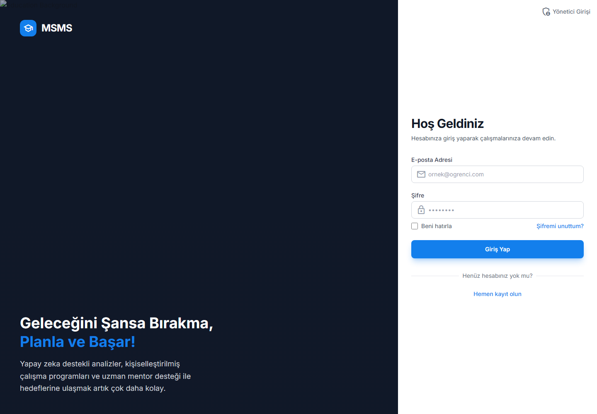](docs/screenshots/login.png) | [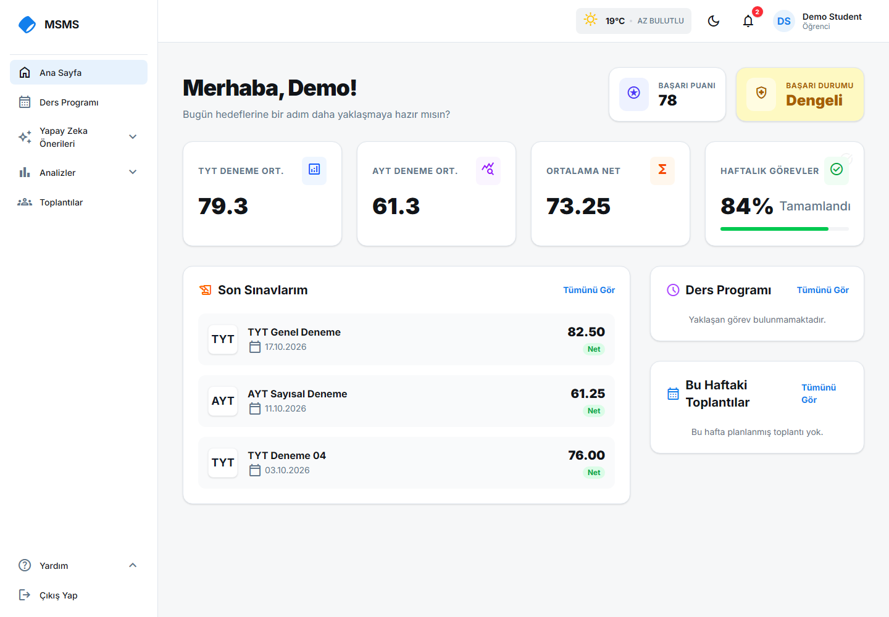](docs/screenshots/home.png) |

| Study schedule | Learning analytics |
| --- | --- |
| [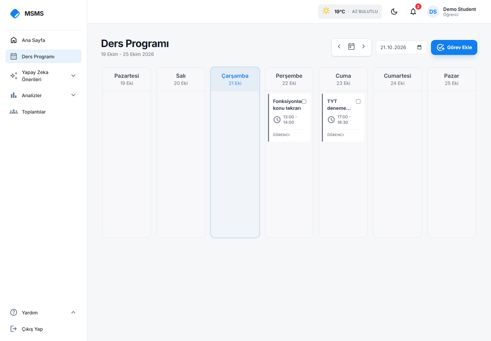](docs/screenshots/schedule.png) | [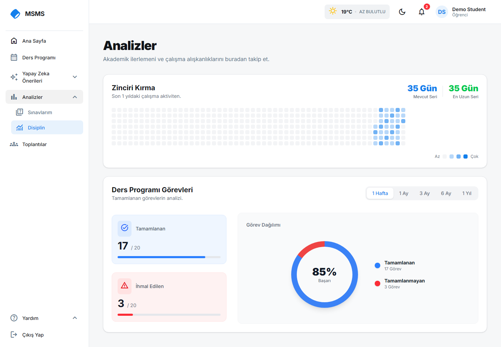](docs/screenshots/analysis.png) |

| Exams | Meetings |
| --- | --- |
| [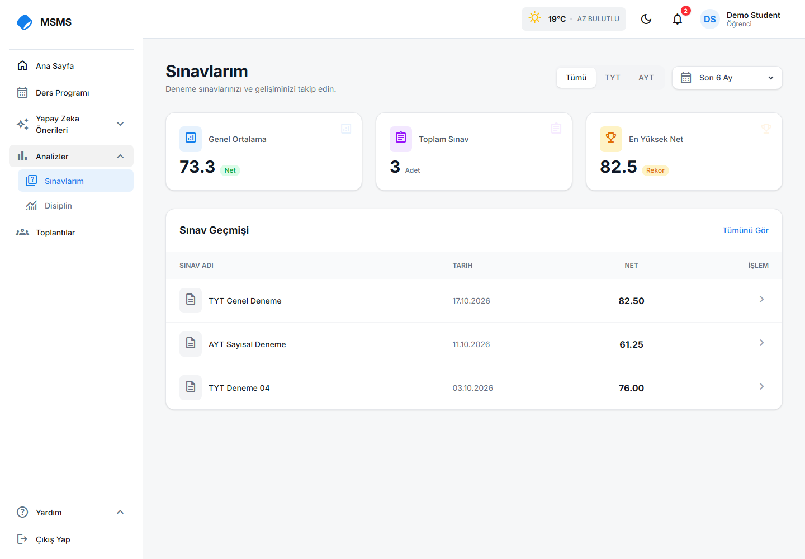](docs/screenshots/exams.png) | [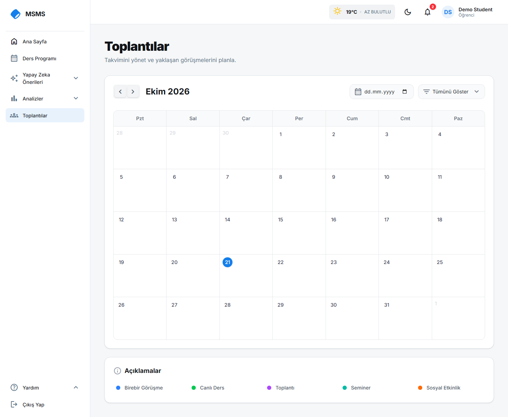](docs/screenshots/meetings.png) |

| Mentor messages | Notifications |
| --- | --- |
| [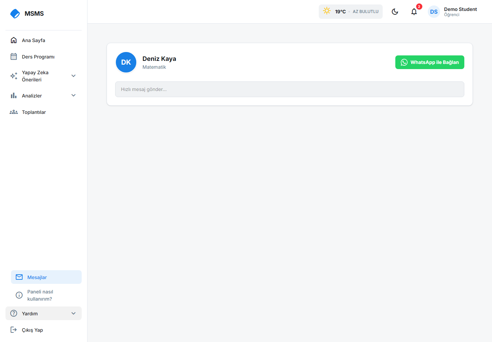](docs/screenshots/messages.png) | [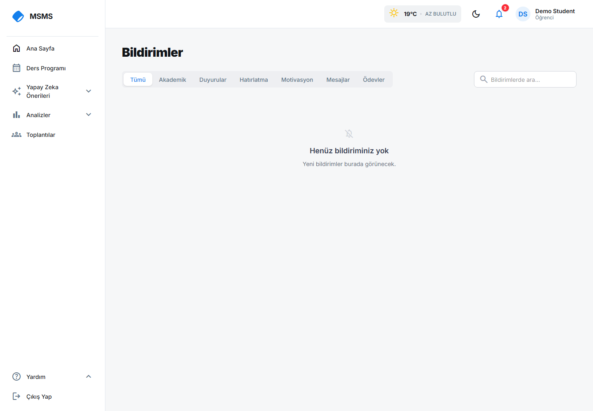](docs/screenshots/notifications.png) |

| Profile | Book sales estimate |
| --- | --- |
| [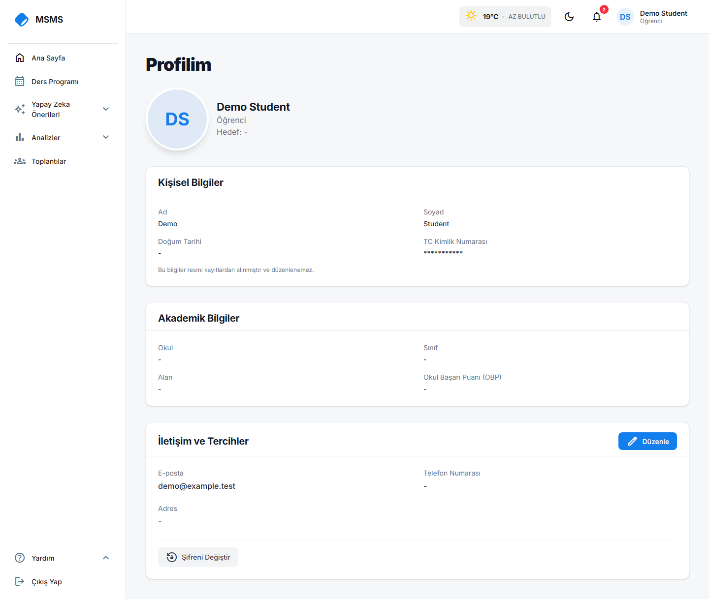](docs/screenshots/profile.png) | [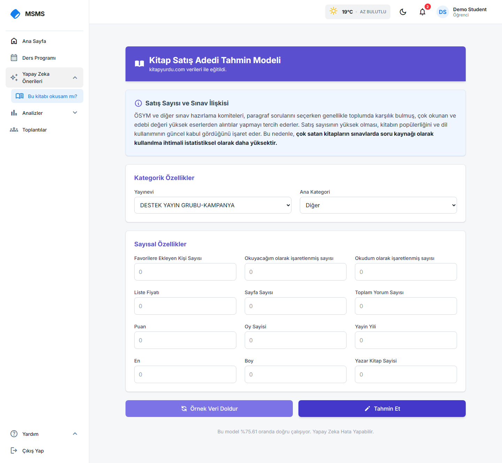](docs/screenshots/book-analysis.png) |

## Features

### Students

- Review recent TYT and AYT exam results and performance summaries.
- Organize weekly study tasks in a calendar.
- Track task completion and study streaks.
- View meetings, notifications, and mentor contact details.
- Estimate a book's sales volume from its publisher, category, and listed attributes.

### Mentors and administrators

- Manage student and mentor accounts.
- Record and review exam results.
- Plan study tasks and mentor meetings.
- View student and task analytics.
- Verify identity through a mock SOAP identity provider used for development.

## AI book analysis

The book analysis service is a supervised **regression** model. Its target is the total sales count in the Kitapyurdu dataset; the application presents this estimate as one signal about a book's popularity.

The serving artifact is a scikit-learn `GradientBoostingRegressor` model. During training, numerical inputs are scaled with `MinMaxScaler`; the model, scaler, and feature list are saved as joblib/JSON artifacts and loaded by the Python prediction service. Inputs include book engagement and rating counts, price, page count, dimensions, publication year, publisher, and category.

The training workspace also contains experiments comparing ten regression approaches, including linear models, K-nearest neighbors, decision trees, random forests, Gradient Boosting, XGBoost, and LightGBM. The comparison code records R², adjusted R², MAE, RMSE, median absolute error, and training time. The deployed prediction service uses the saved Gradient Boosting artifact over gRPC; the Node.js backend exposes the feature to the React application over REST.

## Architecture

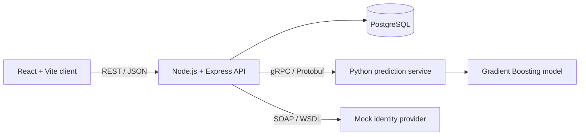

| Component | Location | Responsibility |
| --- | --- | --- |
| React client | `frontend/client/` | Student, mentor, and admin interfaces |
| Express API | `backend/` | Authentication, application APIs, and persistence |
| Database scripts | `database/` | PostgreSQL schema and seed data |
| Python ML service | `external-services/PythonMLEngine/` | Model loading and gRPC prediction endpoint |
| Model experiments | `external-services/BookSalesPrediction/` | Dataset analysis and algorithm comparisons |
| Mock identity service | `external-services/MockIdentityProvider/` | SOAP identity-verification development service |

## Tech stack

- **Frontend:** React, Vite, Tailwind CSS, React Router, Context API
- **Backend:** Node.js, Express, JWT
- **Database:** PostgreSQL
- **ML:** Python, pandas, scikit-learn, joblib
- **Service communication:** REST, gRPC with Protocol Buffers, SOAP/WSDL

## Run locally

### Requirements

- Node.js and npm
- Python 3
- PostgreSQL

### 1. Configure PostgreSQL

Create a local database and apply the schema and seed scripts from `database/`. Configure the database connection for the backend with `DB_USER`, `DB_HOST`, `DB_NAME`, `DB_PASSWORD`, and `DB_PORT`. Set a private `JWT_SECRET` for local development.

### 2. Start the Python prediction service

The checked-in model artifacts are loaded by the gRPC server on port `50051` by default.

```bash
cd external-services/PythonMLEngine
python -m venv .venv
# Windows: .venv\Scripts\activate
# macOS/Linux: source .venv/bin/activate
pip install -r requirements.txt
python grpc_server.py
```

### 3. Start the backend

```bash
cd backend
npm install
npm start
```

The API listens on port `3000` by default. The database connection and JWT signing secret should be supplied through the local environment.

### 4. Start the frontend

```bash
cd frontend/client
npm install
npm run dev
```

Vite prints the local URL when it starts. The client currently calls the API at `http://localhost:3000`.

### Optional: mock identity provider

```bash
cd external-services/MockIdentityProvider
npm install
node server.js
```

## Documentation

Architecture diagrams and project documents are in [`docs/`](docs/). Database schema and seed scripts are in [`database/`](database/). The model training and evaluation workspace is under [`external-services/BookSalesPrediction/`](external-services/BookSalesPrediction/).

## License

Distributed under the MIT License. See [`LICENSE`](LICENSE).
